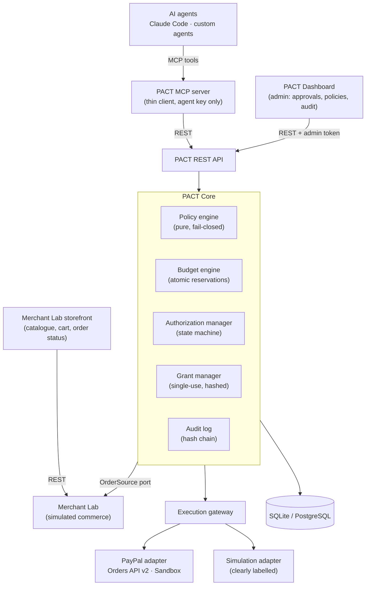
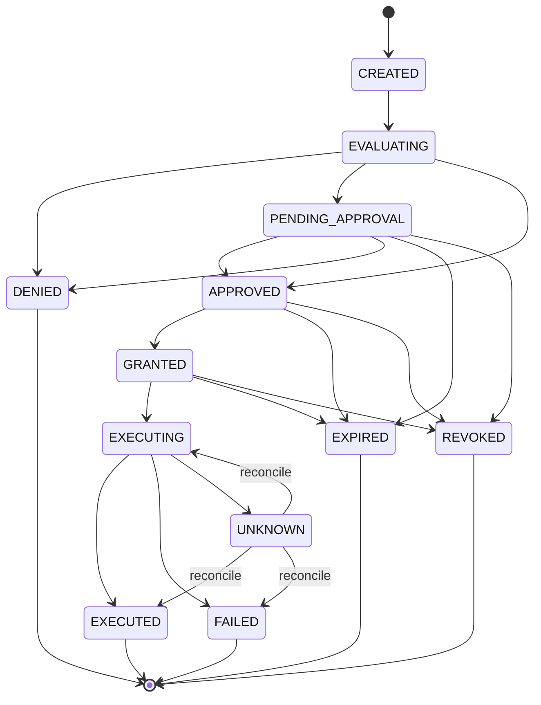

# PACT — Policy and Authorization Control Tower

**A financial governance runtime for autonomous AI agents.** PACT gives organizations deterministic, centralized and auditable control over the payments their AI agents initiate.

```
AI Agent → MCP → PACT Policy Engine → Shared Budget → Human Approval → Restricted Grant → PayPal Sandbox → Audit
```

> **Status:** hackathon MVP for the PayPal AI Hackathon. The full governed payment flow (policy → shared budget → human approval → single-use grant → PayPal Sandbox → audit) is implemented and tested end to end, with an admin dashboard, a Merchant Lab storefront, a REST API, an MCP server for Claude Code and an operator CLI. A complete live PayPal Sandbox capture has not been recorded yet (see [Limitations](#limitations)). See the [roadmap](#roadmap) and [epic #18](https://github.com/MohanPrasand/PACT/issues/18).

---

## Quick start

Requires [uv](https://docs.astral.sh/uv/) (Python 3.11+) and Node 20+ (for the dashboard build).

```bash
uv sync                                   # Python dependencies
cp .env.example .env                      # then set PACT_ADMIN_TOKEN (see below)
python -c "import secrets; print(secrets.token_urlsafe(32))"   # use this as PACT_ADMIN_TOKEN
(cd dashboard && npm ci && npm run build) # dashboard + storefront, served by the API
uv run pact demo                          # seed data, register Claude Code MCP, start the server
```

With `PACT_PAYMENT_PROVIDER=simulation` (the default) no PayPal account is needed and every payment is labelled "Simulation (not PayPal)". For PayPal Sandbox, add the credentials of a Sandbox REST app and set the provider to `paypal`.

Then, in the shopper workspace that `pact demo` prepares, ask Claude: *"Find the best mechanical keyboard under $100 and purchase it."* Approve in the dashboard at <http://localhost:8000/#/admin> (or `uv run pact approve`) and watch the order at <http://localhost:8000/#/shop>. Claude waits for both human steps (approval, then PayPal checkout) and confirms the purchase by itself. Run `uv run pact doctor` if anything looks wrong; details for Claude Code are in [`examples/claude_code/`](examples/claude_code/README.md). The full walkthrough, including the replay-rejection and multi-agent moments, is in [`docs/DEMO.md`](docs/DEMO.md).

---

## Why PACT

AI agents can now buy products, pay invoices and manage subscriptions. Giving each agent its own unrestricted payment integration creates real risk:

- Three agents each within their own limit can **jointly overspend** an organization's budget.
- An agent can **change the order** after a human approved it, or **replay** an approval.
- Merchant, user and organization rules **conflict**, and nobody can say afterwards **why** a payment was allowed.

PACT is the missing operational layer between agents and payment providers: **define financial authority once, enforce it consistently across agents, tools and payment providers.**

PACT is *not* a payment gateway, wallet, processor or a replacement for protocols such as AP2 or PayPal Agent Ready. It complements them with execution-time governance.

## Core principles

1. **Agents request; they do not authorize themselves.** No agent-facing tool can approve a payment.
2. **Policies are deterministic.** A pure function decides ALLOW / DENY / REQUIRE_APPROVAL. The LLM only explains the result.
3. **Authorization is transaction-bound.** An approval is bound to one exact merchant, order, amount and currency.
4. **Budgets are globally coordinated.** All agents draw from one shared ledger with atomic reservations.
5. **Everything is auditable.** Every decision lands in a tamper-evident, hash-chained audit log.

## Architecture



The MCP server holds only an agent API key: no database access, no PayPal secrets, no approval rights. PayPal credentials stay server-side. Details: [`docs/architecture.md`](docs/architecture.md).

### Authorization lifecycle



A provider timeout moves a payment to `UNKNOWN`. It is reconciled against the provider and never retried blindly.

## What's implemented

| Component | Status | Where |
|---|---|---|
| Configuration (fail-fast, sandbox-only, secrets never echoed) | ✅ merged | `pact_core/config.py` |
| Persistence + concurrency model (`BEGIN IMMEDIATE`, conditional updates) | ✅ merged | `pact_core/db.py`, `pact_core/models.py` |
| Authorization state machine (compare-and-set transitions) | ✅ merged | `pact_core/state_machine.py` |
| Deterministic, fail-closed policy engine | ✅ merged | `pact_core/policy/` |
| Tamper-evident audit log | ✅ merged | `pact_core/audit.py` |
| Shared budget engine (atomic reservations, ledger, refunds) | ✅ merged | `pact_core/budget.py` |
| Grant manager (single-use, hashed, transaction-bound) | ✅ merged | `pact_core/grants.py` |
| Authorization service (request, approve, deny, revoke, expire) | ✅ merged | `pact_core/authorization.py` |
| Execution gateway (validation chain, UNKNOWN + reconciliation) | ✅ merged | `pact_core/gateway.py` |
| `PactCore` entry point for REST/MCP | ✅ merged | `pact_core/core.py` |
| Merchant Lab (catalogue, cart, orders, payment status, seed) | ✅ merged | `merchant_lab/` |
| PayPal Sandbox adapter (Orders v2) + simulation adapter | ✅ merged | `adapters/` |
| REST API, CLI (`pact init/serve/verify-audit`), PayPal return/cancel routes | ✅ | `pact_server/` |
| MCP server (16 tools incl. `pact_wait_for_status`; no approval tool) | ✅ | `pact_mcp/` |
| Operator CLI: `pact demo`, `doctor`, `approve`, `stop`, server lock | ✅ | `pact_server/cli.py`, `pact_server/ops.py` |
| Admin dashboard: overview, approval centre, policies, audit explorer (hash-chain verification) | ✅ | `dashboard/src/admin/` |
| Merchant Lab storefront: catalogue, live cart, orders, order status stepper; web checkout governed by PACT | ✅ | `dashboard/src/shop/`, `pact_server/storefront.py` |
| End-to-end acceptance tests (agent, shared budget, web checkout) and multi-agent demo script | ✅ | `tests/test_e2e.py`, `examples/multi_agent_demo.py` |
| Security test matrix, threat model and findings | ✅ | `tests/test_security.py`, [`docs/SECURITY.md`](docs/SECURITY.md) |
| Deployment, demo video | ⏳ Phase 7 (#17) | |

Against PayPal Sandbox, OAuth, order creation and order retrieval have been verified live, including a PACT-governed request → approval → grant → PayPal order. The capture path is covered by tests that run the real PayPal adapter against a mock of Orders v2; a full live run (buyer login, approval, capture) is still to be recorded. INR is rejected by PayPal for this account type (`CURRENCY_NOT_SUPPORTED`), so the demo settles in **USD**.

## Policy model

Five policy sources are evaluated for every request. Each applicable rule emits a *finding*, and the strictest effect wins:

| Source | Example rules |
|---|---|
| **system** (hard) | settlement currency, hard per-transaction cap, allowed actions, order binding, duplicate execution |
| **org** | daily budget shared by all agents, approved merchants, duplicate-payment window |
| **user** | daily limit, approval threshold |
| **merchant** | max agent purchase, allowed categories, allowed agents, approval above amount |
| **agent** | enabled, per-transaction limit, daily cap, allowed merchants |

```
any DENY              → DENY
else any REQUIRE_APPROVAL → REQUIRE_APPROVAL
else                  → ALLOW
```

- **Fail closed:** a missing or malformed policy, or any evaluation error, results in DENY.
- **Never overridden by approval:** human approval cannot override a DENY or a failed budget reservation.
- **Structured result:** every decision carries reason codes, findings with limits and observed values, the policies evaluated with their versions, and a `policy_version` hash.

Reference and example documents: [`specification/policies/`](specification/policies/).

## Repository layout

```
pact_core/            PACT Core: config, db, models, state machine, policy engine, audit,
                      budget, grants, authorization service, execution gateway, PactCore
  policy/             rule schemas + deterministic engine
merchant_lab/         simulated commerce: catalogue, cart, orders, payment status, seed data
adapters/             payment adapters: paypal/ (Orders API v2, Sandbox only), simulation/
pact_server/          REST API (FastAPI), storefront backend and `pact` CLI
pact_mcp/             MCP server for Claude Code (thin client, agent key only)
dashboard/            React + Vite + Tailwind app: admin dashboard (#/admin) and storefront (#/shop)
examples/             claude_code/ setup, multi_agent_demo.py, paypal_sandbox_check.py
specification/        project spec, PROTOCOL.md, policy reference and example policies
docs/                 architecture, DEMO.md, SECURITY.md and implementation plans
tests/                pytest suite
.github/workflows/    CI
```

## Development

Requires [uv](https://docs.astral.sh/uv/) (Python 3.11+).

```bash
uv sync                # create .venv and install dependencies (incl. dev group)
cp .env.example .env   # optional: only needed for PayPal Sandbox mode
uv run pytest          # run the test suite
```

Tests never read `.env` and need no PayPal credentials. Dashboard development: `cd dashboard && npm install && npm run dev` (proxies the API on port 8000); `npm run build` typechecks and builds to `dashboard/dist`. CI (`.github/workflows/ci.yml`) runs `uv sync --locked` + `uv run pytest` and `npm ci` + `npm run build` on every push and pull request to `main`, `dev` and `feat/**`.

### Test suite

| Area | Tests |
|---|---:|
| State machine | 317 |
| Policy engine | 219 |
| PayPal + simulation adapters | 193 |
| Merchant Lab | 140 |
| Grant manager | 75 |
| Budget engine | 57 |
| Configuration | 53 |
| Security matrix (5 expected failures document open findings) | 48 |
| Audit log | 42 |
| Authorization service + execution gateway | 50 |
| REST API, storefront, MCP server | 32 |
| Demo convenience, keys file | 21 |
| End-to-end acceptance | 3 |
| Persistence and concurrency | 6 |
| **Total** | **1256** |

### Branching

`main` ← `dev` ← `feat/*`

- `main`: released, demo-ready code
- `dev`: integration branch
- `feat/*`: feature branches, merged into `dev` through pull requests

Larger phases use an integration branch (e.g. `feat/phase-1-core-foundation`) with parallel per-issue branches. See [`docs/plans/`](docs/plans/).

### Configuration

Settings are read from environment variables or `.env` (see `.env.example`). Invalid configuration fails at startup.

| Variable | Default | Purpose |
|---|---|---|
| `PAYPAL_CLIENT_ID` | — | PayPal Sandbox app client ID (server-side only) |
| `PAYPAL_CLIENT_SECRET` | — | PayPal Sandbox app secret (server-side only, never logged) |
| `PAYPAL_BASE_URL` | `https://api-m.sandbox.paypal.com` | Must be a Sandbox (or local test) URL; live PayPal is rejected |
| `PAYPAL_TIMEOUT_SECONDS` | `15` | HTTP timeout for PayPal calls |
| `PACT_PAYMENT_PROVIDER` | `simulation` | `simulation` or `paypal`; `paypal` requires both PayPal credentials |
| `PACT_DATABASE_URL` | `sqlite:///./pact.db` | SQLAlchemy database URL |
| `PACT_ADMIN_TOKEN` | — | Dashboard/approval bearer token (at least 16 characters, not a placeholder); never given to agents |
| `PACT_CURRENCY` | `USD` | Settlement currency, 3-letter uppercase ISO 4217 code |
| `PACT_PUBLIC_URL` | `http://localhost:8000` | Base URL for PayPal return/cancel redirects |
| `PACT_GRANT_TTL_SECONDS` | `600` | Payment grant lifetime |
| `PACT_APPROVAL_TTL_SECONDS` | `1800` | Human approval window |
| `PACT_EXPIRY_SWEEP_SECONDS` | `15` | Interval of the expiry sweeper |

## Roadmap

| Phase | Scope | Issues | Status |
|---|---|---|---|
| 1 | Core foundation | #1–#5 | ✅ done |
| 2 | Budget, grants, authorization service, execution gateway (+ Merchant Lab, adapters pulled forward) | #6–#11 | ✅ done |
| 5 | REST API, MCP server | #12, #13 | ✅ done |
| 6 | Dashboard, storefront UI | #14, #22–#25 | ✅ done |
| 7 | E2E tests, security review | #15, #16 | ✅ done |
| 7 | Live PayPal Sandbox run, deployment, demo video | #17 and bugs #38–#43 | in progress |

## Positioning

PACT operates alongside Google AP2, Visa Intelligent Commerce, Mastercard Agent Pay, Stripe's agentic payments, PayPal Agent Ready and MCP governance tools. It does not claim to have invented spending limits, human approval or delegated payment permissions. Its contribution is the practical combination of:

- **Shared budgets** across multiple agents
- **Composed policies** from users, merchants and the organization
- **Transaction lifecycle management** and **execution-time enforcement**
- **Provider-independent interfaces** with an **auditable decision trace**

## Limitations

PACT is a sandbox reference implementation for a hackathon, not a certified financial security product. It processes no real money: only PayPal Sandbox endpoints are accepted.

- **Merchant Lab and storefront routes are unauthenticated** (a sandbox commerce simulator). Web checkout can only start a PACT-governed request; it cannot approve, and approval stays in the admin dashboard.
- **Known issues**, tracked in [`docs/SECURITY.md`](docs/SECURITY.md) and the issue tracker: the public payment cancel link (SEC-1, #40), missing framing headers and auth rate limiting (SEC-2, SEC-5), and a set of PayPal Sandbox checkout edge cases (#38–#43). SEC-4 (weak admin token) is fixed.
- **PayPal Sandbox:** a complete live capture is not yet recorded; the buyer must use a Personal sandbox account that differs from the business account.
- **Single instance:** SQLite with `BEGIN IMMEDIATE` serialisation; PostgreSQL is designed for but untested.

Protocol reference: [`specification/PROTOCOL.md`](specification/PROTOCOL.md).

## License

[MIT](LICENSE)
