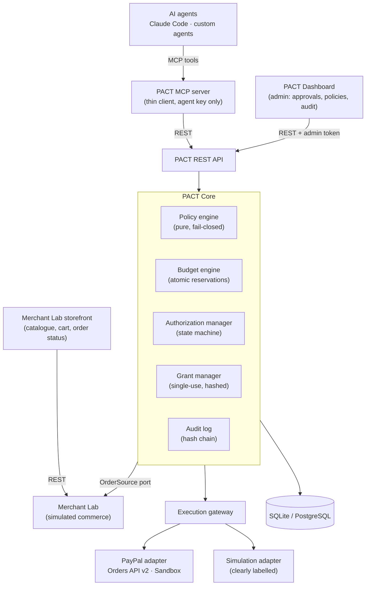
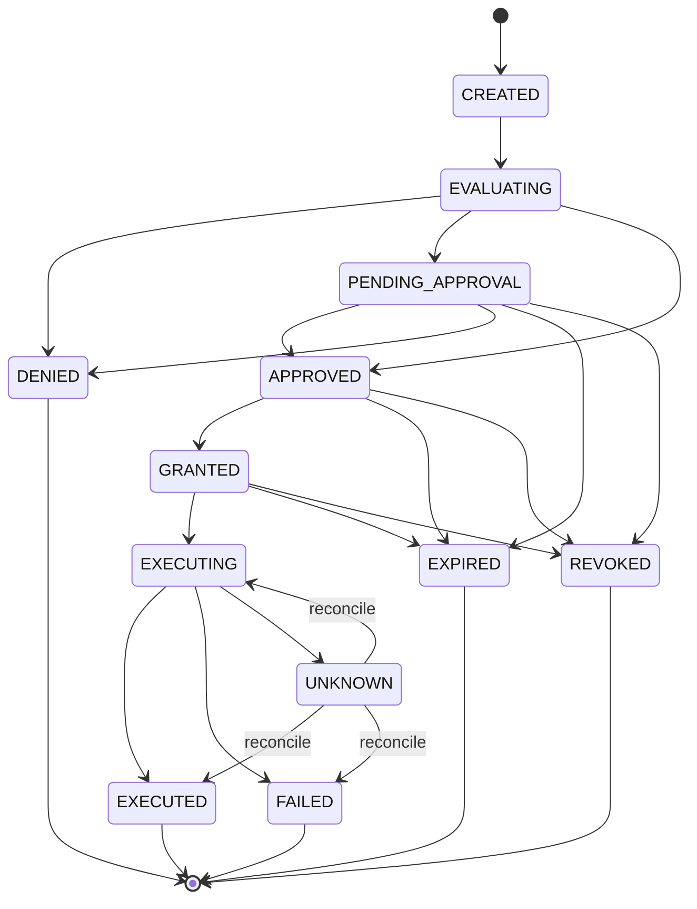

# PACT — Policy and Authorization Control Tower

**A financial governance runtime for autonomous AI agents.** PACT gives organizations deterministic, centralized and auditable control over the payments their AI agents initiate.

```
AI Agent → MCP → PACT Policy Engine → Shared Budget → Human Approval → Restricted Grant → PayPal Sandbox → Audit
```

> **Status:** in development for the PayPal AI Hackathon. Phase 1 (core foundation) is merged; Phase 2 (budget, grants, authorization service) is next. See the [roadmap](#roadmap) and [epic #18](https://github.com/MohanPrasand/PACT/issues/18).

---

## Why PACT

AI agents can now buy products, pay invoices and manage subscriptions. Giving each agent its own unrestricted payment integration creates real risk:

- Three agents each within their own limit can **jointly overspend** an organization's budget.
- An agent can **change the order** after a human approved it, or **replay** an approval.
- Merchant, user and organization rules **conflict**, and nobody can say afterwards **why** a payment was allowed.

PACT is the missing operational layer between agents and payment providers: **define financial authority once, enforce it consistently across agents, tools and payment providers.**

PACT is *not* a payment gateway, wallet, processor or a replacement for protocols such as AP2 or PayPal Agent Ready. It complements them with execution-time governance.

## Core principles

1. **Agents request; they do not authorize themselves.** No agent-facing tool can approve a payment.
2. **Policies are deterministic.** A pure function decides ALLOW / DENY / REQUIRE_APPROVAL. The LLM only explains the result.
3. **Authorization is transaction-bound.** An approval is bound to one exact merchant, order, amount and currency.
4. **Budgets are globally coordinated.** All agents draw from one shared ledger with atomic reservations.
5. **Everything is auditable.** Every decision lands in a tamper-evident, hash-chained audit log.

## Architecture



The MCP server holds only an agent API key: no database access, no PayPal secrets, no approval rights. PayPal credentials stay server-side. Details: [`docs/architecture.md`](docs/architecture.md).

### Authorization lifecycle



A provider timeout moves a payment to `UNKNOWN`. It is reconciled against the provider and never retried blindly.

## What's implemented

| Component | Status | Where |
|---|---|---|
| Configuration (fail-fast, sandbox-only, secrets never echoed) | ✅ merged | `pact_core/config.py` |
| Persistence + concurrency model (`BEGIN IMMEDIATE`, conditional updates) | ✅ merged | `pact_core/db.py`, `pact_core/models.py` |
| Authorization state machine (compare-and-set transitions) | ✅ merged | `pact_core/state_machine.py` |
| Deterministic, fail-closed policy engine | ✅ merged | `pact_core/policy/` |
| Tamper-evident audit log | ✅ merged | `pact_core/audit.py` |
| Shared budget engine, grants, authorization service | 🚧 Phase 2 (#6–#8) | draft on `feat/core-foundation` |
| Merchant Lab | 🚧 Phase 3 (#9) | draft on `feat/core-foundation` |
| Execution gateway, PayPal Sandbox adapter | 🚧 Phase 4 (#10–#11) | draft on `feat/core-foundation` |
| REST API, MCP server | ⏳ Phase 5 (#12–#13) | |
| Dashboard and storefront UI | ⏳ Phase 6 (#14, #22–#25) | |
| E2E demo, security review, deployment | ⏳ Phase 7 (#15–#17) | |

PayPal Sandbox connectivity has been verified (OAuth, order creation and retrieval in USD). INR is rejected by PayPal for this account type (`CURRENCY_NOT_SUPPORTED`), so the demo settles in **USD**.

## Policy model

Five policy sources are evaluated for every request. Each applicable rule emits a *finding*, and the strictest effect wins:

| Source | Example rules |
|---|---|
| **system** (hard) | settlement currency, hard per-transaction cap, allowed actions, order binding, duplicate execution |
| **org** | daily budget shared by all agents, approved merchants, duplicate-payment window |
| **user** | daily limit, approval threshold |
| **merchant** | max agent purchase, allowed categories, allowed agents, approval above amount |
| **agent** | enabled, per-transaction limit, daily cap, allowed merchants |

```
any DENY              → DENY
else any REQUIRE_APPROVAL → REQUIRE_APPROVAL
else                  → ALLOW
```

- **Fail closed:** a missing or malformed policy, or any evaluation error, results in DENY.
- **Never overridden by approval:** human approval cannot override a DENY or a failed budget reservation.
- **Structured result:** every decision carries reason codes, findings with limits and observed values, the policies evaluated with their versions, and a `policy_version` hash.

Reference and example documents: [`specification/policies/`](specification/policies/).

## Repository layout

```
pact_core/            PACT Core: config, db, models, state machine, policy engine, audit
  policy/             rule schemas + deterministic engine
specification/        project spec, policy reference and example policies
docs/                 architecture and implementation plans
tests/                pytest suite
.github/workflows/    CI
```

Planned (later phases): `pact_server/` (REST API + CLI), `pact_mcp/` (MCP server), `merchant_lab/`, `adapters/paypal`, `adapters/simulation`, `dashboard/` (React UI for the admin dashboard and storefront), `examples/claude_code/`.

## Development

Requires [uv](https://docs.astral.sh/uv/) (Python 3.11+).

```bash
uv sync                # create .venv and install dependencies (incl. dev group)
cp .env.example .env   # optional: only needed for PayPal Sandbox mode
uv run pytest          # run the test suite
```

Tests never read `.env` and need no PayPal credentials. CI (`.github/workflows/ci.yml`) runs `uv sync --locked` and `uv run pytest` on every push and pull request to `main`, `dev` and `feat/**`.

### Test suite

| Area | Tests |
|---|---:|
| Policy engine (`tests/test_policy_engine.py`) | 218 |
| State machine (`tests/test_state_machine.py`) | 317 |
| Configuration (`tests/test_config.py`) | 53 |
| Audit log (`tests/test_audit.py`) | 42 |
| Persistence and concurrency (`tests/test_db.py`) | 6 |
| **Total** | **636** |

### Branching

`main` ← `dev` ← `feat/*`

- `main`: released, demo-ready code
- `dev`: integration branch
- `feat/*`: feature branches, merged into `dev` through pull requests

Larger phases use an integration branch (e.g. `feat/phase-1-core-foundation`) with parallel per-issue branches. See [`docs/plans/`](docs/plans/).

### Configuration

Settings are read from environment variables or `.env` (see `.env.example`). Invalid configuration fails at startup.

| Variable | Default | Purpose |
|---|---|---|
| `PAYPAL_CLIENT_ID` | — | PayPal Sandbox app client ID (server-side only) |
| `PAYPAL_CLIENT_SECRET` | — | PayPal Sandbox app secret (server-side only, never logged) |
| `PAYPAL_BASE_URL` | `https://api-m.sandbox.paypal.com` | Must be a Sandbox (or local test) URL; live PayPal is rejected |
| `PAYPAL_TIMEOUT_SECONDS` | `15` | HTTP timeout for PayPal calls |
| `PACT_PAYMENT_PROVIDER` | `simulation` | `simulation` or `paypal`; `paypal` requires both PayPal credentials |
| `PACT_DATABASE_URL` | `sqlite:///./pact.db` | SQLAlchemy database URL |
| `PACT_ADMIN_TOKEN` | — | Dashboard/approval bearer token; never given to agents |
| `PACT_CURRENCY` | `USD` | Settlement currency, 3-letter uppercase ISO 4217 code |
| `PACT_PUBLIC_URL` | `http://localhost:8000` | Base URL for PayPal return/cancel redirects |
| `PACT_GRANT_TTL_SECONDS` | `600` | Payment grant lifetime |
| `PACT_APPROVAL_TTL_SECONDS` | `1800` | Human approval window |
| `PACT_EXPIRY_SWEEP_SECONDS` | `15` | Interval of the expiry sweeper |

## Roadmap

| Phase | Scope | Issues | Status |
|---|---|---|---|
| 1 | Core foundation | #1–#5 | ✅ done |
| 2 | Budget, grants, authorization service | #6, #7, #8 | next |
| 3 | Merchant Lab | #9 | |
| 4 | Execution gateway, PayPal Sandbox | #10, #11 | |
| 5 | REST API, MCP server | #12, #13 | |
| 6 | Dashboard, storefront UI | #14, #22–#25 | |
| 7 | E2E demo, security review, deployment, video | #15, #16, #17 | |

## Positioning

PACT operates alongside Google AP2, Visa Intelligent Commerce, Mastercard Agent Pay, Stripe's agentic payments, PayPal Agent Ready and MCP governance tools. It does not claim to have invented spending limits, human approval or delegated payment permissions. Its contribution is the practical combination of:

- **Shared budgets** across multiple agents
- **Composed policies** from users, merchants and the organization
- **Transaction lifecycle management** and **execution-time enforcement**
- **Provider-independent interfaces** with an **auditable decision trace**

## Limitations

PACT is a sandbox reference implementation for a hackathon, not a certified financial security product. It processes no real money: only PayPal Sandbox endpoints are accepted.

## License

[MIT](LICENSE)
