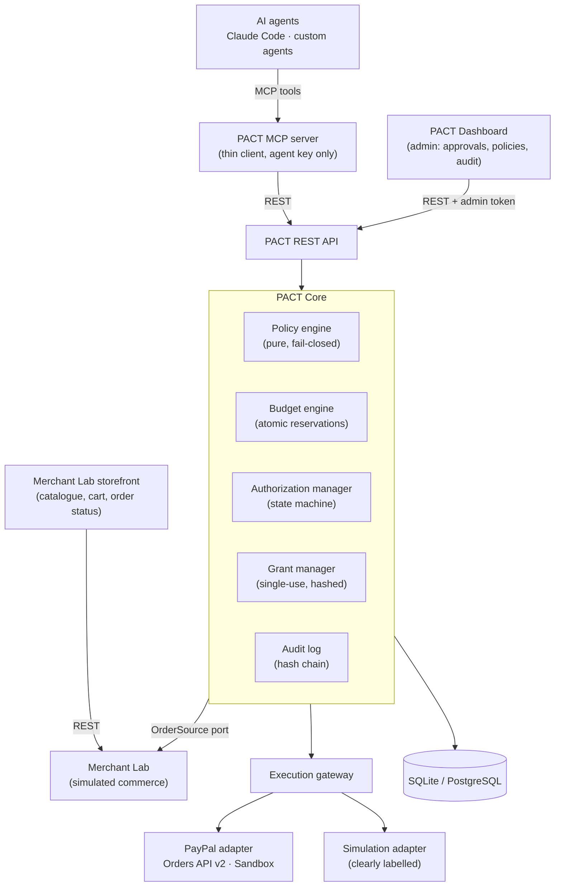
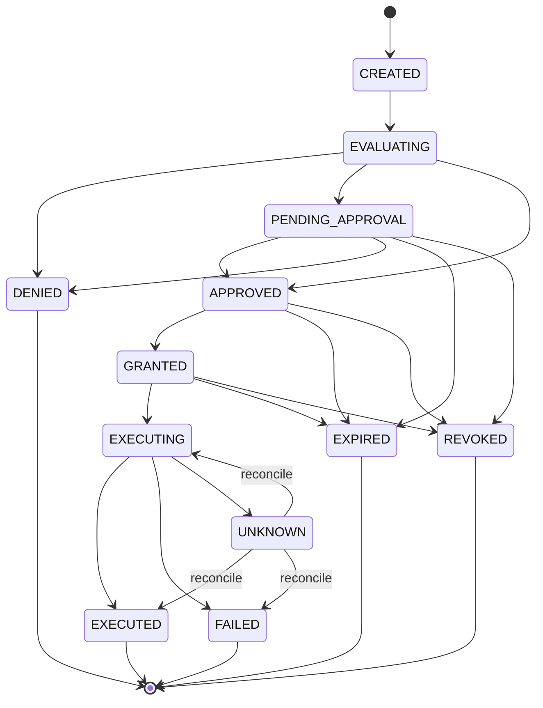

# PACT — Policy and Authorization Control Tower

**A financial governance runtime for autonomous AI agents.** PACT gives organizations deterministic, centralized and auditable control over the payments their AI agents initiate.

```
AI Agent → MCP → PACT Policy Engine → Shared Budget → Human Approval → Restricted Grant → PayPal Sandbox → Audit
```

> **Status:** in development for the PayPal AI Hackathon. Phases 1–2 are complete: the full governed payment flow (policy → shared budget → human approval → single-use grant → payment provider → audit) works in the core and runs end to end with the simulation adapter. Against the live PayPal Sandbox, only OAuth, order creation and order retrieval have been verified; no PayPal-mode payment has yet reached buyer approval or capture, so those steps are covered by automated tests with a mocked PayPal only. The REST API, CLI and MCP server are in place, so Claude Code can run the whole purchase in simulation mode. Next: dashboard and storefront UI. See the [roadmap](#roadmap) and [epic #18](https://github.com/MohanPrasand/PACT/issues/18).

---

## Quick start

```bash
uv sync
cp .env.example .env     # set PACT_ADMIN_TOKEN; for PayPal: PAYPAL_CLIENT_ID/SECRET + PACT_PAYMENT_PROVIDER=paypal
uv run pact demo         # checks config, seeds data, registers the MCP server for ~/pact-shopper, starts PACT
```

Then, in another terminal:

```bash
cd ~/pact-shopper && claude      # ask: "Find the best mechanical keyboard under $100 and buy it."
uv run pact approve              # (from the PACT repo) when Claude says it is waiting for your approval
```

Open the checkout link Claude gives you and pay. Claude waits for both human steps and confirms the purchase by itself.
Anything off? `uv run pact doctor` tells you what and how to fix it. Details: [`examples/claude_code/`](examples/claude_code/README.md).

**PayPal mode.** You need a Sandbox business account, a REST app created under it, and a separate personal Sandbox account for the buyer: see [`docs/paypal-sandbox-setup.md`](docs/paypal-sandbox-setup.md). In PayPal mode `pact doctor` gets an OAuth token and then creates one small test order that nobody pays. It prints the business account that will receive the money and reminds you that the buyer must log in with a different, personal Sandbox account. A passing doctor shows the app and the business account work; it does not test the buyer login, approval or capture.

## Why PACT

AI agents can now buy products, pay invoices and manage subscriptions. Giving each agent its own unrestricted payment integration creates real risk:

- Three agents each within their own limit can **jointly overspend** an organization's budget.
- An agent can **change the order** after a human approved it, or **replay** an approval.
- Merchant, user and organization rules **conflict**, and nobody can say afterwards **why** a payment was allowed.

PACT is the missing operational layer between agents and payment providers: **define financial authority once, enforce it consistently across agents, tools and payment providers.**

PACT is *not* a payment gateway, wallet, processor or a replacement for protocols such as AP2 or PayPal Agent Ready. It complements them with execution-time governance.

## Core principles

1. **Agents request; they do not authorize themselves.** No agent-facing tool can approve a payment.
2. **Policies are deterministic.** A pure function decides ALLOW / DENY / REQUIRE_APPROVAL. The LLM only explains the result.
3. **Authorization is transaction-bound.** An approval is bound to one exact merchant, order, amount and currency.
4. **Budgets are globally coordinated.** All agents draw from one shared ledger with atomic reservations.
5. **Everything is auditable.** Every decision lands in a tamper-evident, hash-chained audit log.

## Architecture



The MCP server holds only an agent API key: no database access, no PayPal secrets, no approval rights. PayPal credentials stay server-side. Details: [`docs/architecture.md`](docs/architecture.md).

### Authorization lifecycle



A provider timeout moves a payment to `UNKNOWN`. It is reconciled against the provider and never retried blindly.

While a request is `EXECUTING` the buyer is at the provider's checkout page. Cancelling there or having a payment method declined does not end the request: the buyer can retry at the same `approval_url`. It ends `FAILED` only on an explicit cancel, a capture the provider rejects, a provider order that no longer exists, or the checkout timeout (`PACT_CHECKOUT_TTL_SECONDS`). See [checkout lifecycle](docs/architecture.md#8-checkout-lifecycle-after-execution-starts).

## What's implemented

| Component | Status | Where |
|---|---|---|
| Configuration (fail-fast, sandbox-only, secrets never echoed) | ✅ merged | `pact_core/config.py` |
| Persistence + concurrency model (`BEGIN IMMEDIATE`, conditional updates) | ✅ merged | `pact_core/db.py`, `pact_core/models.py` |
| Authorization state machine (compare-and-set transitions) | ✅ merged | `pact_core/state_machine.py` |
| Deterministic, fail-closed policy engine | ✅ merged | `pact_core/policy/` |
| Tamper-evident audit log | ✅ merged | `pact_core/audit.py` |
| Shared budget engine (atomic reservations, ledger, refunds) | ✅ merged | `pact_core/budget.py` |
| Grant manager (single-use, hashed, transaction-bound) | ✅ merged | `pact_core/grants.py` |
| Authorization service (request, approve, deny, revoke, expire) | ✅ merged | `pact_core/authorization.py` |
| Execution gateway (validation chain, UNKNOWN + reconciliation) | ✅ merged | `pact_core/gateway.py` |
| `PactCore` entry point for REST/MCP | ✅ merged | `pact_core/core.py` |
| Merchant Lab (catalogue, cart, orders, payment status, seed) | ✅ merged | `merchant_lab/` |
| PayPal Sandbox adapter (Orders v2) + simulation adapter. Live-verified: OAuth, create order, get order. Capture: mocked tests only | ✅ merged | `adapters/` |
| REST API, CLI (`pact init/serve/verify-audit`), PayPal return/cancel routes (exercised with the simulation adapter and mocked PayPal, not yet by a live PayPal buyer) | ✅ | `pact_server/` |
| MCP server (16 tools incl. `pact_wait_for_status`; no approval tool) | ✅ | `pact_mcp/` |
| Operator CLI: `pact demo`, `doctor` (PayPal mode: OAuth + one unpaid test order), `approve`, `cancel` (`--force` for a payment PACT cannot verify), `stop`, server lock | ✅ | `pact_server/cli.py`, `pact_server/ops.py` |
| Dashboard and storefront UI | ⏳ Phase 6 (#14, #22–#25) | |
| E2E demo, security review, deployment | ⏳ Phase 7 (#15–#17) | |

**What has been verified live against PayPal Sandbox:** OAuth, order creation and order retrieval, including a PACT-governed request → human approval in PACT → grant → PayPal order creation. Also run live against real PayPal orders: an early return before approval, the non-terminal cancel link, the explicit buyer cancel, quiet status polling, order-not-found, and the checkout timeout. **What has not:** no PayPal-mode payment has yet reached buyer approval on PayPal's page or capture. Capture, decline, settlement and the unknown-outcome paths are tested against the simulation adapter and a mocked PayPal API only. INR is rejected by PayPal for this account type (`CURRENCY_NOT_SUPPORTED`), so the demo settles in **USD**.

## Policy model

Five policy sources are evaluated for every request. Each applicable rule emits a *finding*, and the strictest effect wins:

| Source | Example rules |
|---|---|
| **system** (hard) | settlement currency, hard per-transaction cap, allowed actions, order binding, duplicate execution |
| **org** | daily budget shared by all agents, approved merchants, duplicate-payment window |
| **user** | daily limit, approval threshold |
| **merchant** | max agent purchase, allowed categories, allowed agents, approval above amount |
| **agent** | enabled, per-transaction limit, daily cap, allowed merchants |

```
any DENY              → DENY
else any REQUIRE_APPROVAL → REQUIRE_APPROVAL
else                  → ALLOW
```

- **Fail closed:** a missing or malformed policy, or any evaluation error, results in DENY.
- **Never overridden by approval:** human approval cannot override a DENY or a failed budget reservation.
- **Structured result:** every decision carries reason codes, findings with limits and observed values, the policies evaluated with their versions, and a `policy_version` hash.

Reference and example documents: [`specification/policies/`](specification/policies/).

## Repository layout

```
pact_core/            PACT Core: config, db, models, state machine, policy engine, audit,
                      budget, grants, authorization service, execution gateway, PactCore
  policy/             rule schemas + deterministic engine
merchant_lab/         simulated commerce: catalogue, cart, orders, payment status, seed data
adapters/             payment adapters: paypal/ (Orders API v2, Sandbox only), simulation/
pact_server/          REST API (FastAPI) and `pact` CLI
pact_mcp/             MCP server for Claude Code (thin client, agent key only)
examples/             claude_code/ setup, paypal_sandbox_check.py (live credential check)
specification/        project spec, policy reference and example policies
docs/                 architecture, PayPal Sandbox setup guide and implementation plans
tests/                pytest suite
.github/workflows/    CI
```

Planned (later phases): `dashboard/` (React UI for the admin dashboard and storefront), `examples/claude_code/`.

## Development

Requires [uv](https://docs.astral.sh/uv/) (Python 3.11+).

```bash
uv sync                # create .venv and install dependencies (incl. dev group)
cp .env.example .env   # optional: only needed for PayPal Sandbox mode
uv run pytest          # run the test suite
```

Tests never read `.env` and need no PayPal credentials. CI (`.github/workflows/ci.yml`) runs `uv sync --locked` and `uv run pytest` on every push and pull request to `main`, `dev` and `feat/**`.

### Test suite

| Area | Tests |
|---|---:|
| State machine | 317 |
| Policy engine | 219 |
| PayPal + simulation adapters | 212 |
| Merchant Lab | 140 |
| Grant manager | 75 |
| Budget engine | 57 |
| Configuration | 69 |
| Authorization service + execution gateway (incl. capture money-safety regressions) | 111 |
| REST API + MCP server | 59 |
| Demo convenience (wait tool, CLI, doctor, lock) | 24 |
| Audit log | 43 |
| Persistence and concurrency | 6 |
| Storefront + agent keys file | 11 |
| **Total** | **1343** |

Counts are per test file, measured on the `fix/paypal-gateway` branch with all of #38–#43 merged.

### Branching

`main` ← `dev` ← `feat/*`

- `main`: released, demo-ready code
- `dev`: integration branch
- `feat/*`: feature branches, merged into `dev` through pull requests

Larger phases use an integration branch (e.g. `feat/phase-1-core-foundation`) with parallel per-issue branches. See [`docs/plans/`](docs/plans/).

### Configuration

Settings are read from environment variables or `.env` (see `.env.example`). Invalid configuration fails at startup.

| Variable | Default | Purpose |
|---|---|---|
| `PAYPAL_CLIENT_ID` | — | PayPal Sandbox app client ID (server-side only) |
| `PAYPAL_CLIENT_SECRET` | — | PayPal Sandbox app secret (server-side only, never logged) |
| `PAYPAL_BASE_URL` | `https://api-m.sandbox.paypal.com` | Must be a Sandbox (or local test) URL; live PayPal is rejected |
| `PAYPAL_TIMEOUT_SECONDS` | `15` | HTTP timeout for PayPal calls |
| `PAYPAL_LANDING_PAGE` | `LOGIN` | First page PayPal shows the buyer: `LOGIN` (PayPal login), `GUEST_CHECKOUT` (card form) or `NO_PREFERENCE` (PayPal decides) |
| `PACT_PAYMENT_PROVIDER` | `simulation` | `simulation` or `paypal`; `paypal` requires both PayPal credentials |
| `PACT_DATABASE_URL` | `sqlite:///./pact.db` | SQLAlchemy database URL |
| `PACT_ADMIN_TOKEN` | — | Dashboard/approval bearer token; never given to agents |
| `PACT_CURRENCY` | `USD` | Settlement currency, 3-letter uppercase ISO 4217 code |
| `PACT_PUBLIC_URL` | `http://localhost:8000` | Base URL for PayPal return/cancel redirects |
| `PACT_GRANT_TTL_SECONDS` | `600` | Payment grant lifetime |
| `PACT_APPROVAL_TTL_SECONDS` | `1800` | Human approval window |
| `PACT_EXPIRY_SWEEP_SECONDS` | `15` | Interval of the expiry sweeper |
| `PACT_CHECKOUT_TTL_SECONDS` | `3600` | How long a checkout may stay `EXECUTING` after the grant is used. The sweeper then checks the provider: a captured payment is finalized, otherwise the request ends `FAILED / CHECKOUT_TIMEOUT` and its budget is released. `0` disables the timeout |

PayPal Sandbox account setup (business account, REST app, personal buyer account): [`docs/paypal-sandbox-setup.md`](docs/paypal-sandbox-setup.md).

## Roadmap

| Phase | Scope | Issues | Status |
|---|---|---|---|
| 1 | Core foundation | #1–#5 | ✅ done |
| 2 | Budget, grants, authorization service, execution gateway (+ Merchant Lab, adapters pulled forward) | #6–#11 | ✅ done |
| 5 | REST API, MCP server | #12, #13 | ✅ done |
| 6 | Dashboard, storefront UI | #14, #22–#25 | next |
| 7 | E2E demo, security review, deployment, video | #15, #16, #17 | |

## Positioning

PACT operates alongside Google AP2, Visa Intelligent Commerce, Mastercard Agent Pay, Stripe's agentic payments, PayPal Agent Ready and MCP governance tools. It does not claim to have invented spending limits, human approval or delegated payment permissions. Its contribution is the practical combination of:

- **Shared budgets** across multiple agents
- **Composed policies** from users, merchants and the organization
- **Transaction lifecycle management** and **execution-time enforcement**
- **Provider-independent interfaces** with an **auditable decision trace**

## Limitations

PACT is a sandbox reference implementation for a hackathon, not a certified financial security product. It processes no real money: only PayPal Sandbox endpoints are accepted.

## License

[MIT](LICENSE)
